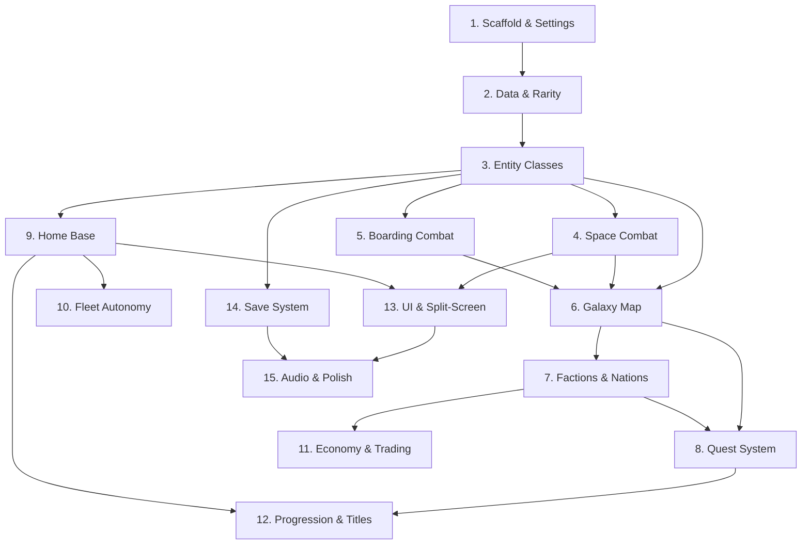

# Space Pirates — Game Plan

## Overview

**Space Pirates** is a top-down 2D desktop game built with Python and Pygame. The player captains a pirate ship, raids enemy vessels for resources and loot, builds and manages a crew, expands a home base, and fights bosses across a galaxy sector map. The game blends roguelite meta-progression with open world exploration — full save persistence between runs, but death rewards progression points spent on permanent upgrades. The core loop is: explore → fight → loot → upgrade → repeat, with escalating difficulty, faction politics, fleet management, and deep customization driving replayability.

**Folder:** `spacePirates/`
**Language:** Python 3
**Framework:** Pygame

---

## Architecture Overview

The game is organized into the following top-level modules:

```
spacePirates/
├── main.py                  # Entry point, game loop
├── settings.py              # Global constants (screen size, colors, rarity tiers etc.)
├── assets/                  # Sprites, fonts, sounds
├── core/
│   ├── game.py              # Main Game class, state manager
│   ├── save.py              # Save/load persistence
│   └── events.py            # Event bus (game-wide events)
├── ui/
│   ├── hud.py               # In-combat HUD
│   ├── menus.py             # All menu screens
│   ├── splitscreen.py       # Split-screen layout manager
│   └── codex.py             # Lore Codex UI
├── world/
│   ├── galaxy.py            # Galaxy/sector map
│   ├── sector.py            # Individual sector logic
│   ├── events.py            # Random space events
│   └── economy.py           # Dynamic economy / pricing
├── entities/
│   ├── ship.py              # Ship base class
│   ├── crew.py              # Crew member class
│   ├── weapon.py            # Weapon class
│   ├── drone.py             # Drone class
│   └── projectile.py        # Projectile class
├── combat/
│   ├── space_combat.py      # Space combat engine
│   ├── boarding.py          # Boarding turn-based combat
│   └── status_effects.py    # Burning, EMP, hull breach etc.
├── fleet/
│   ├── fleet.py             # Fleet manager
│   ├── orders.py            # Ship order system (follow, patrol etc.)
│   └── scrapper.py          # Scrapper ship recovery logic
├── base/
│   ├── home_base.py         # Home base manager
│   ├── buildings.py         # Building definitions and upgrades
│   └── raiders.py           # Base raider wave logic
├── progression/
│   ├── meta.py              # Meta-upgrade tree (progression points)
│   ├── rarity.py            # Rarity system and drop tables
│   └── titles.py            # Pirate title system
├── factions/
│   ├── faction.py           # Faction and Nation base class
│   └── reputation.py        # Reputation manager
├── quests/
│   ├── quest.py             # Quest base class
│   ├── story.py             # Story quest chain
│   ├── procedural.py        # Procedural job board quests
│   └── bounty.py            # Bounty board
└── data/
    ├── ships.json           # Ship definitions
    ├── crew.json            # Crew definitions
    ├── weapons.json         # Weapon definitions
    ├── factions.json        # Faction/nation definitions
    ├── quests.json          # Story/side quest data
    └── lore.json            # Lore codex entries
```

---

## Sub-Tasks

---

### Sub-Task 1 — Project Scaffold & Settings

**Status:** `[ ] pending`

**Intent:**
Set up the project folder, install dependencies, and define all global constants so every subsequent sub-task has a stable foundation to build on.

**Expected Outcomes:**
- `spacePirates/` folder exists with the full directory structure above
- `requirements.txt` lists `pygame` and any other needed packages
- `settings.py` defines screen dimensions, FPS, color palette, rarity tier definitions, and other global constants
- `main.py` opens a Pygame window and runs an empty game loop cleanly
- `core/game.py` has a basic `Game` class with a state machine stub (states: MAIN_MENU, PLAYING, PAUSED, GAME_OVER, BASE, GALAXY_MAP)

**Todo List:**
- [ ] Create `spacePirates/` folder and all sub-folders per the architecture above
- [ ] Create `requirements.txt` with `pygame`
- [ ] Write `settings.py` with screen size, FPS, color constants, and the 6 rarity tier definitions (name, color)
- [ ] Write `main.py` — initializes Pygame, creates `Game` instance, runs game loop
- [ ] Write `core/game.py` — `Game` class with state machine, `update()`, `draw()`, `handle_events()` stubs
- [ ] Write `core/events.py` — simple event bus (subscribe/publish pattern)
- [ ] Write `core/save.py` — stub for save/load using JSON files

**Relevant Context:**
- All rarity tiers: Common (grey), Uncommon (green), Rare (blue), Epic (purple), Legendary (orange/gold), Secret (red/rainbow)
- Game states needed from the start: MAIN_MENU, PLAYING, PAUSED, GAME_OVER, BASE, GALAXY_MAP

---

### Sub-Task 2 — Data Definitions & Rarity System

**Status:** `[ ] pending`

**Intent:**
Define all game entity data (ships, crew, weapons, drones) in JSON data files and implement the rarity system with drop tables. This gives all future sub-tasks a shared data layer to pull from.

**Expected Outcomes:**
- JSON data files populated with at least 3 entries per entity type at varied rarities
- `progression/rarity.py` can roll a random rarity given a luck modifier
- Each entity definition includes a `rarity` field and a `quirks`/`abilities` list

**Todo List:**
- [ ] Write `data/ships.json` — define Fighter, Freighter, Carrier base types with class paths, slot counts, hull types, quirks, rarity
- [ ] Write `data/crew.json` — define crew roles (Pilot, Gunner, Engineer, Combat, Mechanic) with base stats, specialization paths, rarity
- [ ] Write `data/weapons.json` — define Laser, Missile, Railgun, EMP, Flak with upgrade paths, rarity tiers
- [ ] Write `data/factions.json` — define 4 factions, 5 nations, secret faction with reputation thresholds
- [ ] Write `data/quests.json` — stub story quest chain and side quest templates
- [ ] Write `data/lore.json` — stub lore codex entries (one per faction, one per nation, one per secret item)
- [ ] Write `progression/rarity.py` — `RaritySystem` class: roll rarity by luck, get drop table for enemy type, apply rarity multipliers to stats

**Relevant Context:**
- Rarity affects: base stats multiplier, number of quirks/abilities, upgrade stages available, drop rate
- Secret rarity items have unique names, lore descriptions, and game-changing abilities
- Drop rates influenced by: enemy difficulty, boss kills, quest rewards, luck meta-upgrade

---

### Sub-Task 3 — Entity Classes (Ship, Crew, Weapon, Drone)

**Status:** `[ ] pending`

**Intent:**
Implement the core entity classes that represent everything the player owns and fights. These are the building blocks for combat, fleet management, and the UI.

**Expected Outcomes:**
- `Ship` class with modular grid layout, station slots, hull type, quirks, weapon hardpoints (via module slots), crew cabin tracking
- `Crew` class with stats (Piloting, Gunnery, Engineering, Combat, Repair), role, specialization path, XP, morale, relationships
- `Weapon` class with type, upgrade path, XP, rarity, status effect capabilities
- `Drone` class with type, AI behavior stub, rarity
- All classes can be serialized/deserialized to/from their JSON data definitions

**Todo List:**
- [ ] Write `entities/ship.py` — `Ship` class: grid layout, station assignment, hull type, quirks, rarity, naming/cosmetics, serialization
- [ ] Write `entities/crew.py` — `Crew` class: stats dict, role, specialization path, XP system, morale value, relationship list, cabin upgrade tracking, serialization
- [ ] Write `entities/weapon.py` — `Weapon` class: type, path A/B upgrade tree, XP system, rarity, status effect on hit, serialization
- [ ] Write `entities/drone.py` — `Drone` class: type (combat/utility), stats, rarity, AI behavior enum, serialization
- [ ] Write `entities/projectile.py` — `Projectile` class: speed, damage, owner, status effect payload
- [ ] Add `equip_best()` method to `Ship` — auto-assigns highest stat crew to best-matching stations

**Relevant Context:**
- Ship stations: Cockpit, Gun Turrets, Engine Room, Repair Station, Drone Bay, Brig
- Crew stats map to stations: Piloting→Cockpit, Gunnery→Gun Turrets, Engineering→Engine Room, Repair→Repair Station, Combat→Brig/Boarding
- Crew specialization paths unlock at a mid-level XP threshold
- Weapon specialization paths unlock at XP thresholds from kills while equipped

---

### Sub-Task 4 — Space Combat Engine

**Status:** `[ ] pending`

**Intent:**
Implement the core top-down real-time space combat system — movement, shooting, enemy AI, status effects, and the pause-to-order mechanic.

**Expected Outcomes:**
- Player ship moves and fires in a top-down 2D view
- Enemy ships have basic AI (chase, strafe, retreat when low HP)
- Weapons fire projectiles with correct damage, range, and status effects
- Status effects (burning, EMP'd, hull breach, boarded, system offline) apply and tick correctly
- Player can pause combat and issue crew orders (which station to man)
- Kill grants progression point + triggers loot drop
- Nebula sector modifier applies (reduced visibility, weapon malfunction chance, shield drain)

**Todo List:**
- [ ] Write `combat/space_combat.py` — `SpaceCombat` class: update loop, collision detection, projectile management, enemy spawning
- [ ] Implement player ship movement (keyboard) and firing (mouse aim or auto from gunner crew)
- [ ] Implement basic enemy AI states: PATROL, CHASE, ATTACK, RETREAT
- [ ] Write `combat/status_effects.py` — each status effect as a class with `apply()`, `tick()`, `expire()` methods
- [ ] Implement pause mechanic — freeze combat state, open crew order menu overlay
- [ ] Implement kill reward: +1 progression point, trigger `RaritySystem` drop roll, spawn loot pickup
- [ ] Implement nebula combat modifiers as a sector flag passed into `SpaceCombat`
- [ ] Wire crew station assignments to combat stats (gunner crew stat affects fire rate/damage, pilot affects speed/evasion)

**Relevant Context:**
- Status effects: burning (damage over time), EMP'd (disables weapons temporarily), hull breach (ongoing hull damage), boarded (triggers boarding combat), system offline (disables a random station)
- Crew at stations boost performance: higher Gunnery stat = better fire rate/crit, higher Piloting = better speed/evasion
- Wanted Level increases with piracy actions — tracked in `progression/meta.py`

---

### Sub-Task 5 — Boarding Combat

**Status:** `[ ] pending`

**Intent:**
Implement the turn-based room-by-room boarding combat system, the hostage mechanic, and the ship capture/keep/sell outcome.

**Expected Outcomes:**
- Player can initiate boarding from space combat when enemy ship is weakened
- Boarding combat is turn-based, menu-driven, room by room
- Player selects troops to send, troops fight enemy crew per room
- Outcome options: capture ship (keep/sell), take hostages (ransom or crew slot), retreat
- Captured ship added to player fleet or sold for credits

**Todo List:**
- [ ] Write `combat/boarding.py` — `BoardingCombat` class: room list from enemy ship grid, turn order, action menu (attack, use ability, retreat)
- [ ] Implement troop selection menu — pick which crew members to send on boarding party
- [ ] Implement room-by-room progression — clear a room to advance to next, each room has enemy crew defenders
- [ ] Implement hostage mechanic — option to capture surviving enemy crew (ransom for credits or add to your roster)
- [ ] Implement capture outcome screen — keep ship (add to fleet), sell ship (credits based on rarity/condition), strip for parts
- [ ] Wire boarding result back to `SpaceCombat` — remove enemy ship from combat, add to fleet or credits

**Relevant Context:**
- Crew Combat stat and Infiltrator specialization path affect boarding effectiveness
- Enemy ship room layout comes from its modular grid definition
- Brig station on player ship holds hostages

---

### Sub-Task 6 — Galaxy Map & Sector System

**Status:** `[ ] pending`

**Intent:**
Implement the galaxy sector map — the overworld the player navigates between combat encounters. Sectors have difficulty ratings, nation/faction ownership, bosses, and special types (Ship Graveyard, Nebula).

**Expected Outcomes:**
- Galaxy map screen shows named sectors as nodes with connections
- Each sector has: difficulty tier, owning nation/faction, enemy types, boss flag, special type flag
- Player can travel between connected sectors (costs fuel)
- Entering a sector loads the appropriate combat/exploration environment
- Ship Graveyard sector has unique derelict event logic
- Nebula sectors pass combat modifiers to `SpaceCombat`
- Seasonal event sectors appear/disappear on a timer

**Todo List:**
- [ ] Write `world/galaxy.py` — `Galaxy` class: sector node graph, travel logic, fuel cost calculation, current sector tracking
- [ ] Write `world/sector.py` — `Sector` class: difficulty, nation, faction, enemy spawn table, boss flag, special type (NORMAL, GRAVEYARD, NEBULA, NATION_SAFE, SEASONAL)
- [ ] Implement galaxy map UI screen — draw sector nodes, connections, player position, sector info tooltip
- [ ] Implement sector entry — load correct environment based on sector type
- [ ] Implement Ship Graveyard logic — ancient derelict event with traps and high-tier loot
- [ ] Implement Seasonal Event sectors — time-gated flag on sector node, unique loot table
- [ ] Implement fuel consumption on travel — warn player if fuel low, strand if empty

**Relevant Context:**
- Nation safe zone sectors: no combat, have stations with quests/shops/cantina
- Sector difficulty scales enemy ship rarity and count
- Boss sectors are gate nodes — player must defeat boss to unlock next difficulty tier
- Fuel managed in `entities/ship.py` fuel tank stat

---

### Sub-Task 7 — Factions, Nations & Reputation

**Status:** `[ ] pending`

**Intent:**
Implement the faction and nation systems, reputation tracking, and all the gameplay effects reputation has (prices, aggression, exclusive content, inter-faction relationships).

**Expected Outcomes:**
- 4 factions and 5 nations each have a reputation score with the player
- Reputation changes based on player actions (attacking faction ships, completing quests, trading)
- Faction/nation aggression, prices, quest availability, and item access gated by reputation
- Secret Faction hidden until discovered through lore — joining locks out all others
- Nations have signature bosses and nation-exclusive items

**Todo List:**
- [ ] Write `factions/faction.py` — `Faction` and `Nation` classes: name, description, reputation score, thresholds (hostile/neutral/friendly/allied), exclusive items list
- [ ] Write `factions/reputation.py` — `ReputationManager`: adjust rep on action, check access level, apply price modifier, check aggression
- [ ] Implement inter-faction relationships — attacking faction A raises rep with their enemy faction B
- [ ] Implement Secret Faction discovery — triggered by collecting enough lore codex entries, joining flag locks other factions hostile
- [ ] Implement nation safe zone enforcement — no enemy spawns in nation sectors, nation guards attack hostile players
- [ ] Wire reputation into shop pricing, quest availability, and dialogue flags
- [ ] Populate `data/factions.json` with full faction/nation definitions, rep thresholds, exclusive item refs

**Relevant Context:**
- Factions: Space Pirates, Merchant Guild, Military, Scavengers
- Nations: Terran Compact (military), Merchant Syndicate (trade), Free Colonies (salvage), Technocracy (drones/AI), Void Collective (mysterious/alien)
- Secret Faction: revealed through lore codex, grants best secret items, makes all others hostile

---

### Sub-Task 8 — Quest System

**Status:** `[ ] pending`

**Intent:**
Implement all four quest types — story, side, procedural job board, and bounty board — along with the Rival Pirate Captain NPC arc.

**Expected Outcomes:**
- Story quest chain progresses through sectors toward the final boss, with branching based on faction reputation
- Side quests available at nation stations, tracked in quest log
- Procedural job board generates varied missions (kill X, deliver cargo, rescue crew, escort)
- Bounty board lists named enemy captains with unique ships
- Rival Pirate Captain appears at story milestones, grows in power, becomes penultimate boss
- Quest rewards grant: resources, rare crew/items, bonus progression points, reputation

**Todo List:**
- [ ] Write `quests/quest.py` — `Quest` base class: title, description, objectives list, reward definition, status (AVAILABLE/ACTIVE/COMPLETE/FAILED)
- [ ] Write `quests/story.py` — story quest chain with milestones, faction reputation checks for branching, final boss unlock condition, multiple ending flags
- [ ] Write `quests/procedural.py` — `JobBoard` class: generate random quests from templates (kill, deliver, rescue, escort), refresh on sector visit
- [ ] Write `quests/bounty.py` — `BountyBoard` class: spawn named enemy captain ships with unique loadouts and loot
- [ ] Implement Rival Pirate Captain NPC — scripted appearances at story milestones, stat scaling with player progression, unique ship and crew
- [ ] Implement quest log UI — active/available/completed tabs, objective tracking, reward preview
- [ ] Wire quest completion to reward distribution (resources, loot roll, progression points, rep change)

**Relevant Context:**
- Multiple endings determined by: which factions are allied vs hostile at final boss, story quest choices made
- Rival Captain penultimate boss appears before final boss in story quest chain
- Nation-exclusive quests gated by reputation level with that nation

---

### Sub-Task 9 — Home Base

**Status:** `[ ] pending`

**Intent:**
Implement the home base as the player's persistent hub — a physically expanding space station with upgradeable buildings, resource storage, crew management, and base raider defense events.

**Expected Outcomes:**
- Home base screen shows the station visually, growing as buildings are added
- All 8 buildings implemented with upgrade tiers costing resources
- Base raider waves trigger periodically with notification system
- Player can warp back to base to help defend
- Research Lab hosts the meta-upgrade tree for spending progression points

**Todo List:**
- [ ] Write `base/home_base.py` — `HomeBase` class: building registry, resource storage, expansion visual state, warp-in trigger
- [ ] Write `base/buildings.py` — define all 8 buildings (Shipyard, Barracks, Armory, Warehouse, Research Lab, Cantina, Trading Post, Defense Turrets) with upgrade tiers, costs, and effects
- [ ] Implement Research Lab meta-upgrade tree — tree of permanent upgrades purchased with progression points (starting ship quality, crew slots, resource multipliers, luck, etc.)
- [ ] Implement Barracks crew training — spend resources to accelerate crew XP
- [ ] Write `base/raiders.py` — `RaiderWave` class: wave difficulty scales with Wanted Level and story progression, guard ships + turrets auto-defend, notification to player
- [ ] Implement base expansion visual — base sprite/layout updates as new buildings are constructed
- [ ] Implement home base UI screen — building grid, resource totals, access to all building menus

**Relevant Context:**
- Base starts as a derelict asteroid station claimed early in story quest
- Buildings unlock features: Cantina→crew recruitment, Armory→weapon storage/management, Shipyard→ship repair/switching
- Defense Turrets built at base reduce raider damage automatically

---

### Sub-Task 10 — Fleet Autonomy System

**Status:** `[ ] pending`

**Intent:**
Implement the fleet management system — assigning orders to ships, mission board, scrapper recovery, patrol/collect behavior, and Fleet Admiral role.

**Expected Outcomes:**
- Each fleet ship can be assigned one of 5 orders: Follow, Guard Base, Patrol & Collect, Mission, Standby
- Mission board at home base lets player assign ships to timed missions
- Scrapper ships auto-recover wrecked ships and injured crew
- Patrol ships earn XP and resources autonomously, can be ambushed (alert sent)
- Fleet Admiral crew member provides passive bonus to all autonomous ships

**Todo List:**
- [ ] Write `fleet/fleet.py` — `Fleet` class: list of owned ships, order assignment, fleet-wide stat queries
- [ ] Write `fleet/orders.py` — `OrderSystem`: FOLLOW, GUARD_BASE, PATROL_COLLECT, MISSION, STANDBY order logic, simulate autonomous ship actions on time tick
- [ ] Implement mission board — available missions with difficulty, timer, success chance formula (based on crew/ship stats), warp-in assist trigger
- [ ] Write `fleet/scrapper.py` — `ScrapperShip` logic: detect destroyed friendly ships, fly to wreck, recover crew (injured state) and hull (repairable), return to base
- [ ] Implement patrol simulation — on sector time tick, patrol ships roll for: resource find, enemy encounter, loot drop, ambush alert
- [ ] Implement Fleet Admiral role — assign crew member as admiral via Barracks, passive bonus applied to all autonomous ship stat rolls
- [ ] Implement mercenary hiring — Cantina offers temporary mercenary ships for hire, removed from fleet after mission/sector

**Relevant Context:**
- Injured crew have a recovery timer before they can be assigned again
- Wrecked ships need Shipyard repair (resource cost based on damage level)
- Fleet Command (late game) — command multiple ships simultaneously in large fleet battles, unlock via Research Lab meta-upgrade

---

### Sub-Task 11 — Economy & Trading

**Status:** `[ ] pending`

**Intent:**
Implement the dynamic economy, trading systems, Black Market, Auction House, contraband, and fuel/supply management.

**Expected Outcomes:**
- Resource prices fluctuate per sector based on supply/demand simulation
- Player can buy/sell at Trading Post (home base) and nation station markets
- Contraband items flagged as illegal in certain nations — scanned on entry, confiscated if caught
- Black Market vendor spawns hidden in specific sectors — sells high-rarity items for rare currency
- Auction House at nation stations — timed auctions with NPC bidders
- Ships consume fuel between sectors, supplies consumed over time

**Todo List:**
- [ ] Write `world/economy.py` — `Economy` class: price table per resource per sector, supply/demand fluctuation on player trades and time ticks
- [ ] Implement Trading Post UI — buy/sell resources, ships, crew contracts, weapons
- [ ] Implement contraband system — item flag `is_contraband`, nation entry scan (chance to catch based on Wanted Level), confiscation or bribe option
- [ ] Implement Black Market — hidden sector vendor, rare currency (`Void Credits`) as payment, high-rarity loot table
- [ ] Implement Auction House — timed auction events at nation stations, NPC bidders, player bids with credits
- [ ] Implement fuel consumption — deduct fuel on sector travel, supply consumption on time tick, resupply at stations and home base
- [ ] Wire Merchant Syndicate reputation into sell price bonuses

**Relevant Context:**
- Contraband flagged in `data/ships.json`, `data/weapons.json` etc.
- Wanted Level (tracked in `progression/meta.py`) increases scan catch chance
- Black Market uses `Void Credits` — rare drop from Secret Faction enemies and Ship Graveyard

---

### Sub-Task 12 — Progression, Meta-Upgrades & Titles

**Status:** `[ ] pending`

**Intent:**
Implement the full progression loop — death handling, meta-upgrade tree, pirate title system, and New Game+ unlock.

**Expected Outcomes:**
- On death: show run summary (kills, quests, ships captured), award banked progression points, prompt meta-upgrade spend
- Meta-upgrade tree persists across all runs
- Pirate Title System awards titles based on kill count and Wanted Level, affects NPC dialogue
- New Game+ triggers after final boss — restarts with all meta-upgrades, harder enemies, new secret content
- Captain's Log auto-records run history

**Todo List:**
- [ ] Write `progression/meta.py` — `MetaProgression` class: progression point bank, upgrade tree definition and purchase logic, Wanted Level tracker, New Game+ flag
- [ ] Implement death screen — run summary stats, progression point award, transition to meta-upgrade tree
- [ ] Implement meta-upgrade tree UI — tree graph of upgrades (starting ship quality, crew slots, resource multipliers, luck, fleet slots, base building discounts etc.)
- [ ] Write `progression/titles.py` — `TitleSystem`: title definitions with unlock conditions (kill thresholds, Wanted Level thresholds), active title display, NPC dialogue flag checks
- [ ] Implement Captain's Log — auto-append entries on: kills, quests completed, ships captured, bosses defeated, crew deaths
- [ ] Implement New Game+ — on final boss defeat, offer NG+ with scaling enemy stats and secret content flags unlocked
- [ ] Implement Captain origin selection at new game start — 3–4 origins with starting bonus and dialogue flags

**Relevant Context:**
- Progression points sourced from: enemy kills (1 per kill), boss kills (bonus), quest completions (bonus)
- Meta-upgrades unlock or enhance: home base starting state, fleet size limits, drop luck, crew stat floors
- Titles affect: NPC vendor prices (fear discount), enemy aggression (some flee), unique quest triggers

---

### Sub-Task 13 — UI & Split-Screen Layout

**Status:** `[ ] pending`

**Intent:**
Implement the full UI layer — split-screen layout, all menus, HUD, lore codex, accessibility options, and photo mode.

**Expected Outcomes:**
- Split-screen: left panel = space combat view, right panel = ship interior management menu
- All management screens accessible from right panel: crew assignment, ship modules, weapons loadout, drone bay
- "Equip Best" button on crew/station management screen
- HUD shows: hull, shields, fuel, crew morale, active status effects, wanted level
- Lore Codex accessible from main menu and base
- Accessibility options: combat speed slider, colorblind rarity mode, font size
- Photo Mode: pause + screenshot with filter options

**Todo List:**
- [ ] Write `ui/splitscreen.py` — `SplitScreen` layout manager: left surface (combat), right surface (management panel), resize/toggle logic
- [ ] Write `ui/hud.py` — in-combat HUD: hull bar, shield bar, fuel gauge, morale indicator, status effect icons, wanted level stars
- [ ] Write `ui/menus.py` — all menu screens: main menu, pause menu, crew management, ship loadout, weapon management, drone bay, quest log, galaxy map, base screen
- [ ] Implement "Equip Best" button — calls `ship.equip_best()`, animates crew assignments, shows diff of changes
- [ ] Write `ui/codex.py` — Lore Codex UI: entry list by category, unlock state, entry detail view with lore text
- [ ] Implement accessibility settings screen — combat speed (0.5x–2x slider), colorblind toggle (changes rarity colors to shape-coded), font size (S/M/L)
- [ ] Implement Photo Mode — pause state, filter selector (none/vintage/noir/neon), screenshot save to disk
- [ ] Implement notification system — toast popups for: base raid alert, mission assist alert, patrol ambush alert, auction ending, new lore entry

**Relevant Context:**
- Right panel management is menu-based (not real-time drag-and-drop) to keep controls simple
- Rarity colors in colorblind mode: Common=circle, Uncommon=square, Rare=diamond, Epic=star, Legendary=crown, Secret=skull
- Combat speed slider affects `SpaceCombat` time delta multiplier

---

### Sub-Task 14 — Save System & Persistence

**Status:** `[ ] pending`

**Intent:**
Implement full save/load persistence — run state, home base state, fleet, meta-upgrades, faction reputation, quest progress, codex, and captain's log all saved to disk.

**Expected Outcomes:**
- Game auto-saves on: sector transition, base visit, quest completion, death
- Manual save available from pause menu
- Save file is human-readable JSON
- Load correctly restores all game state including fleet orders, base buildings, and meta-upgrade tree
- Multiple save slots supported

**Todo List:**
- [ ] Write `core/save.py` — `SaveSystem` class: serialize/deserialize full game state to JSON, auto-save triggers, save slot management (3 slots)
- [ ] Implement save data schema — define all fields saved per slot (player stats, fleet, base, progression, factions, quests, codex, log, NG+ flag)
- [ ] Implement auto-save triggers — hook into sector transition, base entry, quest completion, death events via `core/events.py`
- [ ] Implement load screen — slot selection, show run summary per slot (playtime, sector, kill count)
- [ ] Implement new game flow — origin selection → starting ship assignment → tutorial quest trigger → first sector load

**Relevant Context:**
- All entity classes (Ship, Crew, Weapon, Drone) implement `to_dict()` / `from_dict()` for serialization
- Meta-upgrades and faction reputation persist across deaths (never reset)
- Run-specific state (current sector, active quests, current ship loadout) resets on death but is restored from last auto-save if game closed mid-run

---

### Sub-Task 15 — Audio & Polish

**Status:** `[ ] pending`

**Intent:**
Add sound effects, background music, visual polish (particle effects, screen shake, animations), and final integration pass to make the game feel complete.

**Expected Outcomes:**
- Background music loops per sector type (combat, safe zone, base, graveyard)
- Sound effects for: weapons firing, explosions, boarding, UI clicks, loot pickup, level up
- Particle effects for: weapon impacts, explosions, engine trails, status effects
- Screen shake on heavy impacts
- All systems integrated and tested end-to-end

**Todo List:**
- [ ] Add `assets/sounds/` and `assets/music/` folders with placeholder audio files
- [ ] Implement audio manager in `core/game.py` — music by game state/sector type, SFX triggers
- [ ] Implement particle system — `Particle` class, emitters for explosions, engine trails, weapon impacts
- [ ] Implement screen shake — triggered by heavy hits, boss attacks, explosions
- [ ] Add ship insignia/color cosmetic rendering to ship sprites
- [ ] Integration pass — play through full loop: new game → sector combat → base → death → meta-upgrade → new run
- [ ] Fix any integration bugs found during pass
- [ ] Add README.md with setup instructions (`pip install -r requirements.txt`, `python main.py`)

**Relevant Context:**
- Pygame `mixer` module handles audio
- Particle system should be lightweight — use object pooling if particle count gets high
- Photo Mode screenshot should capture the Pygame surface before HUD overlay

---

## Implementation Order



---

## Key Design Decisions

| Decision | Choice | Reason |
|----------|--------|--------|
| Language/Framework | Python 3 + Pygame | Cross-platform, accessible, fast to prototype |
| Combat style | Real-time with pause | Tactical depth without turn-based slowness |
| Management style | Menu-based | Keeps controls simple, accessible |
| Progression | Roguelite + open world hybrid | Best of both — freedom and replayability |
| Data storage | JSON files | Human-readable, easy to extend without code changes |
| Save format | JSON | Transparent, debuggable |
| Ship layout | Modular grid | Physical customization that scales with ship rarity |
| Boarding | Turn-based menu | Manageable complexity, distinct feel from space combat |
